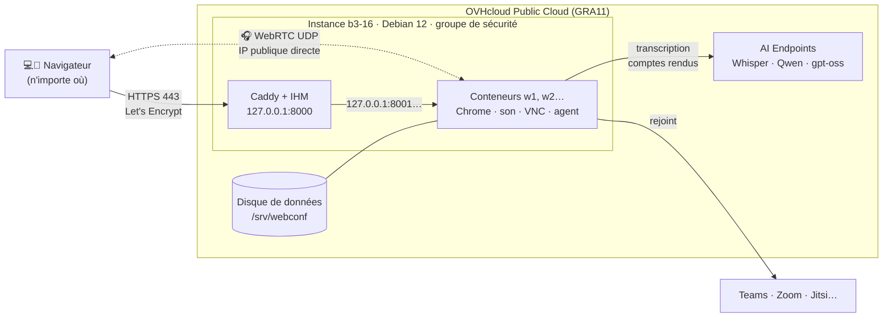

# Déploiement chez OVHcloud (Terraform)

Une instance **Public Cloud** Debian 12 porte tout : l'IHM et ses workers en conteneurs, comme la VM
`webconf-ct` testée sur Proxmox. Terraform crée l'infrastructure, puis `deploy-ovh.sh` installe le
logiciel avec les scripts habituels (`deploy-containers.sh`, `install-control.sh`).



## Pourquoi cette forme

- **Une seule instance** : l'IHM et les workers se parlent en local (127.0.0.1), aucun port interne
  n'est exposé. Pour plus de réunions simultanées : `worker_count` et un gabarit plus grand.
- **IP publique directe** (réseau `Ext-Net`) : l'audio WebRTC passe sans NAT, donc **sans Tailscale
  ni serveur TURN**, y compris depuis un iPhone en 4G.
- **Certificat Let's Encrypt** obtenu par Caddy : le micro fonctionne dans Safari (iPhone, iPad).
- **Disque de données séparé** : enregistrements, transcriptions et comptes rendus survivent à la
  reconstruction de l'instance.
- **Secrets hors de Terraform** : la clé OVH AI Endpoints et le jeton des agents sont envoyés par SSH
  depuis `.ovh_token` et `.agent_token` ; ils n'apparaissent ni dans le code ni dans l'état Terraform.
- **Même fournisseur** que les modèles (AI Endpoints), données hébergées en France.

## Prérequis

1. Un **projet Public Cloud** OVHcloud.
2. Un **utilisateur OpenStack** : Manager > Public Cloud > *Users & Roles* > créer un utilisateur
   (rôle *Compute Operator* + *Network Operator* + *Volume Operator*, ou *Administrator*), puis
   **télécharger le fichier OpenStack RC** de la région voulue.
3. **Terraform** ≥ 1.5 (ou OpenTofu) et une clé SSH.
4. Facultatif : un **nom de domaine** (enregistrement A vers l'IP de l'instance). Sans domaine,
   l'adresse `https://<ip-avec-tirets>.sslip.io` est utilisée (pratique pour un essai).

## Déploiement

```bash
cd deploy/ovh
source ~/openrc.sh                       # variables OS_* (demande le mot de passe OpenStack)
cp terraform.tfvars.example terraform.tfvars && nano terraform.tfvars   # admin_cidrs, région…
terraform init
terraform apply                          # ~2 min : instance, pare-feu, disque
./deploy-ovh.sh                          # ~10 min : Docker, image worker, workers, IHM
```

Le script affiche l'adresse de l'IHM ; le mot de passe est `ADMIN_PASSWORD` dans
`/etc/webconf/control.env` sur l'instance (`ssh debian@<ip>`).

Avec un domaine : créer l'enregistrement A juste après `terraform apply` (IP dans
`terraform output public_ipv4`), avant `./deploy-ovh.sh`, pour que Let's Encrypt le trouve.

**Vérifier sans compte OVH** : `terraform test` (fournisseur simulé : adresse, workers, règles du
pare-feu, refus d'un SSH ouvert à tous). Essai de l'installation sur une VM ordinaire :
`TLS_MODE=internal ./deploy-ovh.sh` (certificat interne au lieu de Let's Encrypt).

**Mise à jour du code** : relancer `./deploy-ovh.sh` (réglages et données conservés).
**Plus de workers** : changer `worker_count`, puis `terraform apply` et `./deploy-ovh.sh`.

## Réglages (`terraform.tfvars`)

| Variable | Défaut | Rôle |
|---|---|---|
| `region` | `GRA11` | région (ex. `SBG5`, `EU-WEST-PAR`) |
| `flavor` | `b3-16` | 4 vCPU / 16 Go pour 2 à 3 workers ; `b3-32` pour 4 à 6 |
| `admin_cidrs` | (obligatoire) | adresses autorisées en SSH |
| `web_cidrs` | tout Internet | adresses autorisées sur l'IHM (443) |
| `webrtc_cidrs` | tout Internet | adresses autorisées pour l'audio (UDP) |
| `domain` | (vide → sslip.io) | nom de l'IHM |
| `worker_count` | `2` | réunions simultanées |
| `data_volume_gb` / `volume_type` | `100` / `classic` | disque des enregistrements |

Un worker utilise environ 1 Go de mémoire et une fraction de cœur pendant une réunion (mesuré sur
`webconf-ct`) ; la transcription et les comptes rendus sont calculés par AI Endpoints.

## Sécurité

- **Groupe de sécurité OpenStack** : SSH réservé à `admin_cidrs` ; 80 (défi Let's Encrypt et
  redirection) et 443 ; UDP 1024-65535 pour WebRTC. Les ports des workers (API 8001+, VNC 6080+)
  ne sont pas ouverts : le pare-feu nftables de l'instance les réserve en plus à 127.0.0.1.
- **IHM sur Internet** : protégée par le mot de passe (aléatoire, 16 caractères) et un cookie de
  session sécurisé. Pour la réserver à quelques adresses : `web_cidrs`. Pour ne pas l'exposer du
  tout : `web_cidrs = []` et accès par Tailscale (`deploy/enable-tailscale.sh`).
- SSH par clé uniquement, mises à jour de sécurité automatiques (cloud-init).

## Coûts et arrêt

Facturation à l'heure (instance + disque). **`terraform destroy` supprime tout, disque de données
compris** : copier d'abord les enregistrements (`rsync`) si besoin. Pour un usage ponctuel, l'instance
peut être mise en veille (*shelve*) depuis le Manager : seul le stockage reste facturé (à vérifier
dans la grille tarifaire OVHcloud).

## Pistes non retenues

- **Kubernetes managé (MKS)** : possible, mais les workers ont besoin du réseau de l'hôte (WebRTC,
  une plage UDP), d'un écran virtuel par pod et d'une réunion par pod ; beaucoup de complexité pour
  2 à 6 réunions simultanées.
- **Une instance par worker** : plus d'isolation mais plus cher et plus lent à démarrer ; utile
  seulement au-delà d'une dizaine de réunions simultanées (avec un réseau privé vRack entre l'IHM et
  les workers).
