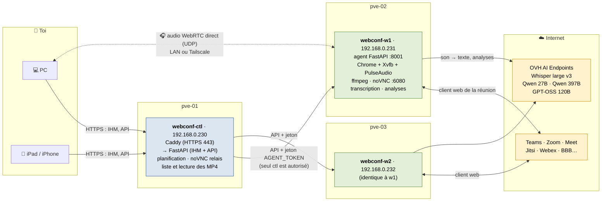
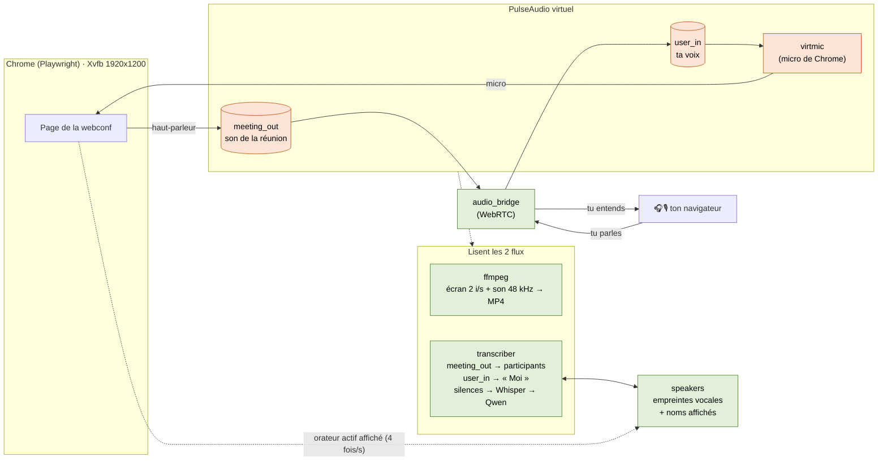
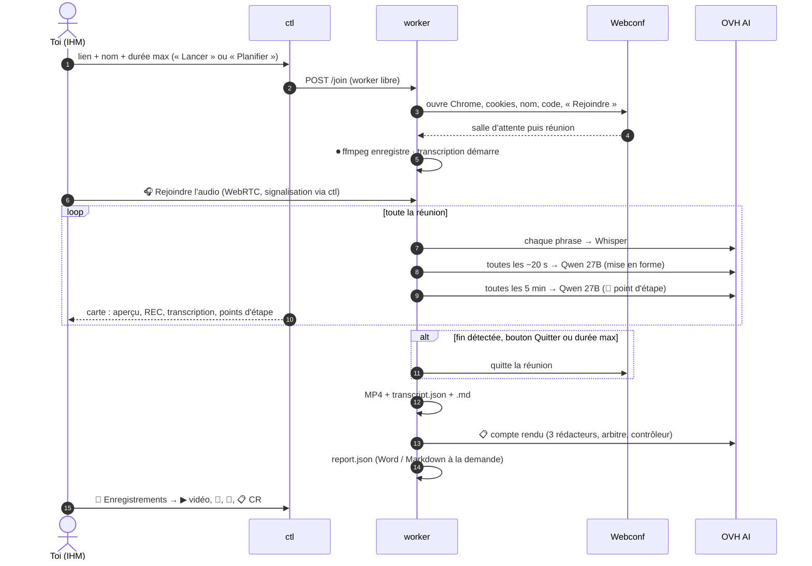
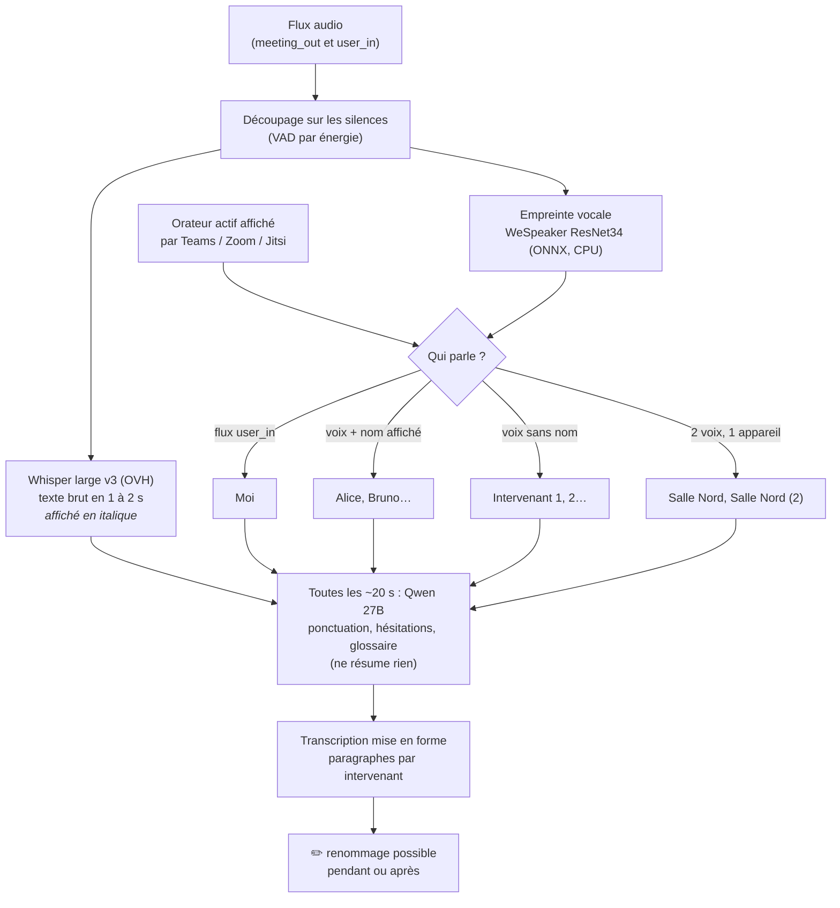
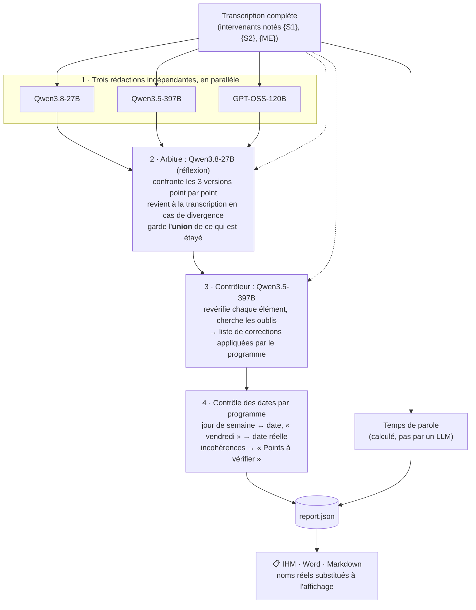
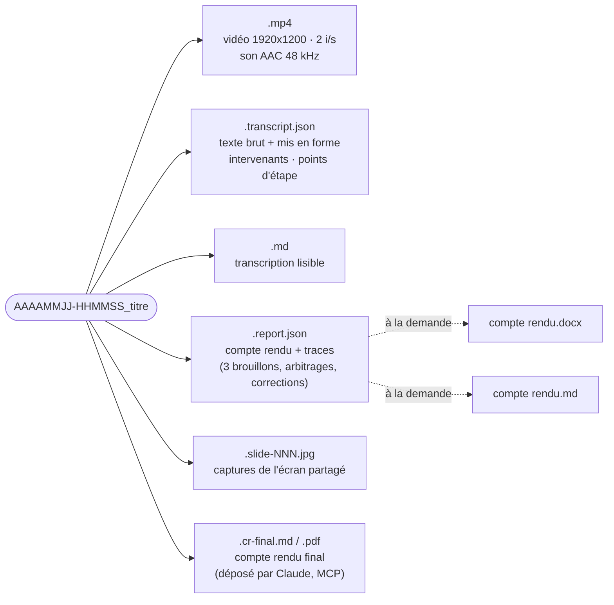
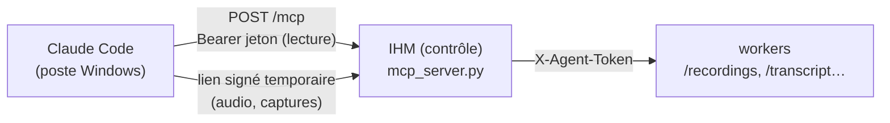
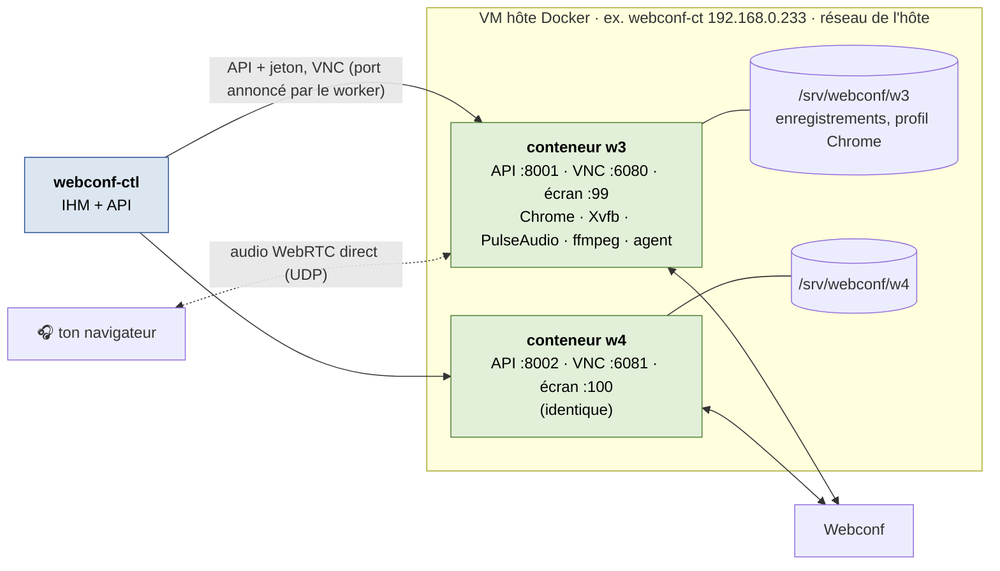

# Omniconf : schémas d'architecture

Les schémas sont en Mermaid (GitLab les affiche directement). Une version modifiable dans draw.io
est dans [`architecture.drawio`](architecture.drawio) : ouvrir avec https://app.diagrams.net ou
l'extension draw.io de VS Code.

1. [Vue d'ensemble](#1-vue-densemble)
2. [Intérieur d'un worker : le circuit du son](#2-intérieur-dun-worker--le-circuit-du-son)
3. [Déroulé d'une réunion](#3-déroulé-dune-réunion)
4. [De la voix au texte : transcription et intervenants](#4-de-la-voix-au-texte--transcription-et-intervenants)
5. [Compte rendu multi-modèles](#5-compte-rendu-multi-modèles)
6. [Fichiers produits](#6-fichiers-produits)
7. [Variante : workers en conteneurs](#7-variante--workers-en-conteneurs)

---

## 1. Vue d'ensemble

- **ctl** ne fait que piloter : il ne rejoint aucune réunion. Il choisit un worker libre et relaie
  la signalisation WebRTC et l'écran distant.
- **Chaque worker** rejoint **une** réunion à la fois : deux workers, deux réunions en parallèle.
- **Le son** circule directement entre ton navigateur et le worker (WebRTC). Il ne passe pas par ctl.

---

## 2. Intérieur d'un worker : le circuit du son

- Ta voix arrive par un flux séparé (`user_in`) : elle est toujours attribuée à « Moi » sans erreur.
- Le son de la réunion (`meeting_out`) mélange tous les autres : c'est là que les empreintes vocales
  séparent les personnes, et que les noms affichés par la plateforme leur donnent un nom.

---

## 3. Déroulé d'une réunion

---

## 4. De la voix au texte : transcription et intervenants

---

## 5. Compte rendu multi-modèles

**Contenu du compte rendu** : objet, synthèse, à retenir, tableau des décisions, tableau des actions,
« Pour moi » (ce qui te concerne), déroulé par sujet (positions de chacun, conclusion), questions ouvertes, risques,
chiffres, dates, prochaine réunion, points à vérifier, temps de parole, annexe « méthode et contrôle ».

---

## 6. Fichiers produits

Dans `/srv/webconf/recordings/` sur le worker :

## 6 bis. Accès de Claude (serveur MCP)

Le serveur est sans état (réponses JSON, versions du protocole 2024-11-05 à 2026-07-28). Il transforme les
fichiers de la réunion (transcription, compte rendu, diapositives) en données prêtes à rédiger : locuteur résolu
par phrase (nom affiché par la plateforme > voix reconnue > « Intervenant N »), participants et organisations,
segments suspects, séquences hors réunion, indicateur de captation du micro de l'utilisateur.

---

## 7. Variante : workers en conteneurs

Les workers peuvent tourner en conteneurs Docker sur une VM hôte (`deploy/deploy-containers.sh`).
Le contrôle et l'IHM ne changent pas : il suffit de déclarer les conteneurs dans `WORKERS`.

- Dans chaque conteneur, les 5 services d'une VM worker tournent sous `supervisord`.
- Les conteneurs utilisent le réseau de l'hôte : chacun a donc ses propres ports et son propre écran.
- Un conteneur = une réunion à la fois, comme une VM.
